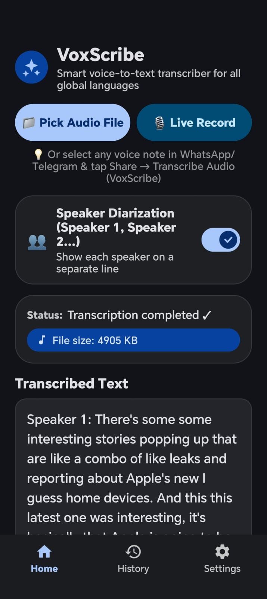
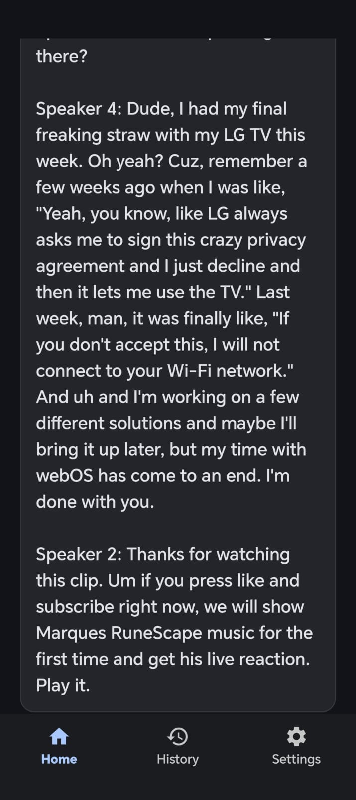
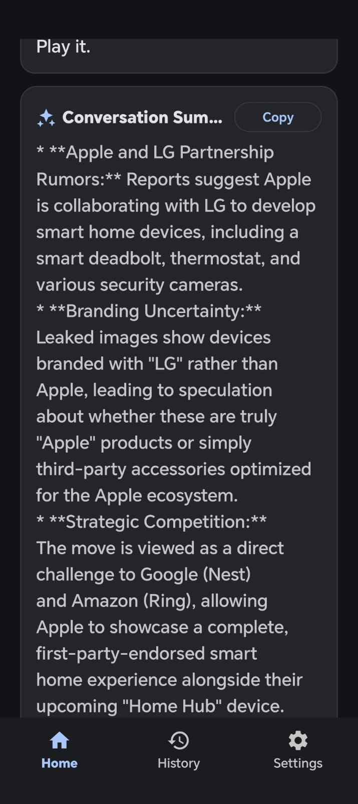
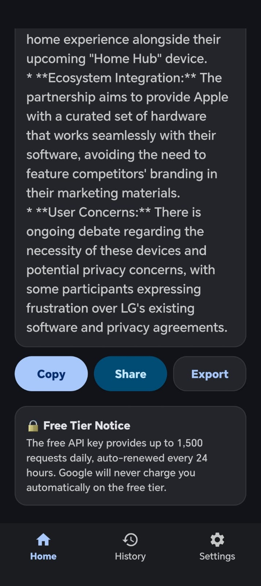
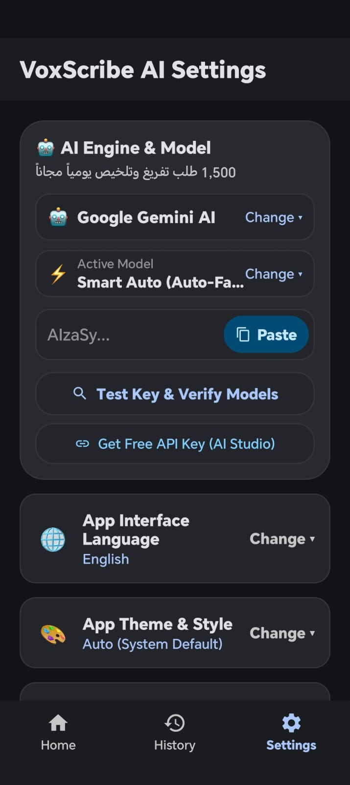
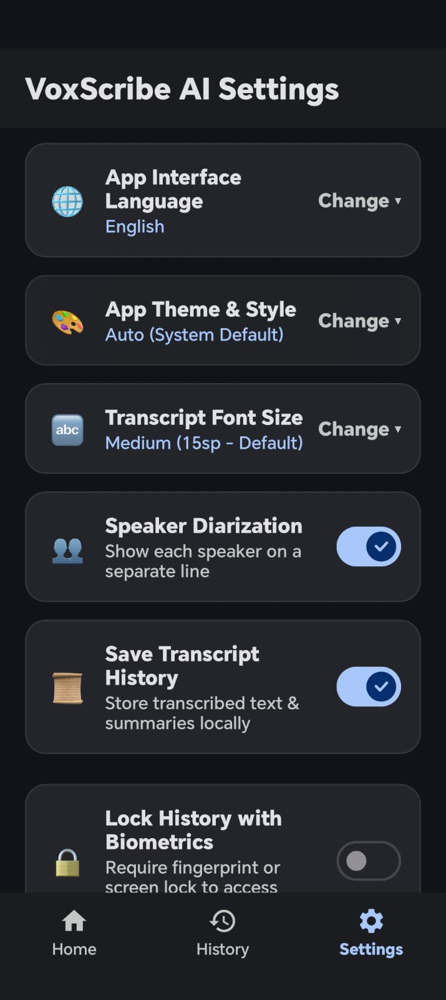
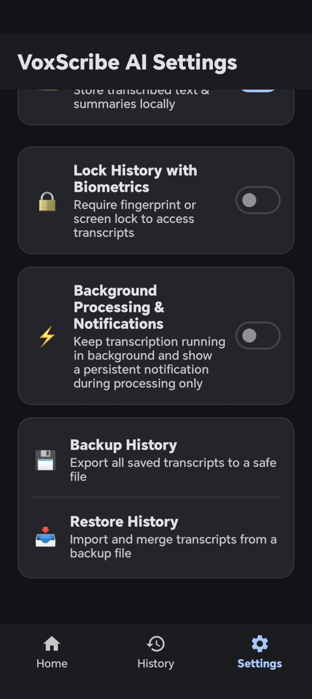

<div align="center">

# 🎙️ VoxScribe AI
### Next-Gen Multilingual Audio Transcription & Intelligence Engine for Android
**Smart Speaker Diarization • Real-Time SSE Streaming • Multi-Model Auto-Failover • Biometric Privacy**

---

[-3DDC84?logo=android&logoColor=white)](https://android.com)
[](https://java.com)
[](https://aistudio.google.com)
[](https://material.io)
[](https://buymeacoffee.com/hxh3mk)
[](LICENSE)

[**English**](#-overview) • [**العربية (Arabic)**](#-نظرة-عامة-عن-التطبيق)

---

</div>

## 📸 Screenshots Showcase / معاينة التطبيق

| Home Screen | Speaker Diarization | AI Executive Summary |
| :---: | :---: | :---: |
|  |  |  |

| Export & Actions | AI Engine & Auto-Failover | Settings & AMOLED | Biometrics & Backup |
| :---: | :---: | :---: | :---: |
|  |  |  |  |

---

## 🇬🇧 Overview

**VoxScribe AI** is an ultra-fast, privacy-first native Android audio transcription and voice intelligence application. Powered by cutting-edge multimodal AI models (Google Gemini, OpenAI Whisper, Anthropic Claude, and Groq Cloud), VoxScribe transforms voice recordings, lectures, meetings, and WhatsApp/Telegram audio notes into crystal-clear formatted text in real time.

Designed with a modern **Material Design 3** philosophy and **AMOLED True-Black** theme, VoxScribe provides a distraction-free experience with zero bloat and complete user control over API keys and local data.

### ✨ Key Features

- **⚡ Real-Time SSE Streaming Transcription:**
  Text streams dynamically word-by-word and paragraph-by-paragraph right before your eyes via Server-Sent Events (`streamGenerateContent?alt=sse`). No waiting for long recordings to finish before seeing results.

- **👥 Native Speaker Diarization:**
  Accurately detects and separates multiple speakers on individual conversational lines formatted in the speaker's native language (e.g., *Speaker 1 / Speaker 2*, *المتحدث 1 / المتحدث 2*).

- **🔄 Smart Multi-Model Auto-Failover:**
  Never get blocked by rate limits or 429 quota exhaustion. If a Gemini model hits its free-tier daily cap, VoxScribe automatically and seamlessly cascades to the next best available model in the quota pool (`gemini-3.5-flash-lite` -> `gemini-3.1-flash-lite` -> `gemini-2.0-flash` etc.) without stopping your transcription.

- **📲 Universal Audio Ingestion & Instant Share Sheet:**
  - One-tap share directly from **WhatsApp**, **Telegram**, voice recorder apps, and file managers.
  - Built-in live audio recorder with waveform playback preview.
  - Support for all major audio formats (`OGG`, `OPUS`, `MP3`, `M4A`, `WAV`, `AAC`, `FLAC`, `AMR`).

- **💡 AI Executive Summary:**
  Automatically generates concise, actionable bullet points and key takeaways from any transcribed audio meeting or voice note.

- **🔒 Local-First Biometric Security:**
  All history and scripts are kept 100% locally on your device. Secure your history vault with biometric authentication (Fingerprint / Face Unlock / Screen Lock PIN).

- **💾 Multi-Format Export & History Backup:**
  - Export transcripts and summaries directly to `PDF` and `TXT`.
  - Full encrypted backup and restore functionality to safeguard your transcripts across devices.

- **🌍 12+ Localized Languages:**
  Fully localized interface in Arabic, English, Spanish, French, German, Japanese, Korean, Portuguese, Russian, Turkish, Urdu, and Persian.

- **🔋 Battery-Friendly Background Processing:**
  Optional background worker with persistent status notifications during active jobs, allowing long audio files to process smoothly without keeping the screen active.

---

## 🇸🇦 نظرة عامة عن التطبيق

**VoxScribe AI** هو تطبيق أندرويد متطور واحترافي لتحويل الصوت إلى نص وتلخيص الملاحظات الصوتية والمحادثات بالاعتماد على أحدث نماذج الذكاء الاصطناعي العالمية (Google Gemini و OpenAI Whisper و Claude و Groq).

تم تصميم التطبيق بواجهة **Material You (Material 3)** عصرية تدعم الوضع الداكن الحقيقي **(AMOLED Pitch Black)** بالكامل، ومصمم ليكون فائق السرعة، خفيف الحجم، ويحمي خصوصية المستخدم تماماً.

### 🌟 أبرز المميزات والقدرات

1. **⚡ البث والتدفق المباشر للنص (Real-time SSE Streaming):**
   تتدفق الكلمات والفقرات وتظهر حية على الشاشة أولاً بأول أثناء معالجة الصوت دون الحاجة للانتظار حتى ينتهي التسجيل.

2. **👥 تمييز وفصل المتحدثين (Speaker Diarization):**
   يتعرف الذكاء الاصطناعي على نبرات المتحدثين ويفصل كل شخص في سطر مستقل مع تسميته بلغته المنطوقة (*المتحدث 1: ...*، *المتحدث 2: ...*).

3. **🔄 التبديل الذكي التلقائي عند استهلاك الحصة (Smart Auto-Failover):**
   في حال وصول أي نموذج للحد المجاني اليومي (خطأ 429)، يقوم التطبيق تلقائياً بالتحويل السلس والفوري لأفضل نموذج بديل متاح بدون مقاطعة أو توقف.

4. **📲 دعم المشاركة المباشرة من واتساب وتليجرام:**
   يمكنك تحديد أي رسالة صوتية (Voice Note) في واتساب أو تليجرام واختيار "مشاركة" ثم "تفريغ الصوت" ليبدأ فوراً.

5. **🎙️ مسجل صوتي مدمج ومعاينة سريعة:**
   تسجيل الصوت مباشرة من داخل التطبيق مع مشغل صوتي مصغر للتحقق قبل التفريغ.

6. **💡 تلخيص ذكي للمحتوى (Smart AI Summary):**
   استخراج ملخص تنفيذي ونقاط رئيسية سريعة فور اكتمال التفريغ لمساعدتك في فهم المحتوى فوراً.

7. **🔒 حماية السجل بالبصمة والأمان الحيوي:**
   بياناتك وسجلاتك محفوظة محلياً بالكامل على جهازك، مع إمكانية قفل السجل ببصمة الإصبع أو رمز قفل الشاشة.

8. **📤 خيارات تصدير ونسخ احتياطي شاملة:**
   تصدير النصوص والملخصات بصيغ `PDF` و `TXT` المنسقة مع دعم النسخ الاحتياطي والاستعادة.

9. **🌍 دعم أكثر من 12 لغة عالمية:**
   واجهة تدعم العربية، الإنجليزية، الفرنسية، الإسبانية، الألمانية، التركية، وغيرها.

---

## 🛠️ Architecture & Tech Stack

- **Platform:** Native Android (Min SDK: 26 / Android 8.0 Oreo, Target SDK: 34 / Android 14)
- **Language:** Clean Java (Java 8 bytecode compatibility)
- **Networking:** Native `HttpURLConnection` with Server-Sent Events (SSE) streaming & zero heavy third-party networking bloat
- **Design System:** Material Design 3, Dynamic Dark / AMOLED Pitch Black, Custom Animated Switches & Wavy Progress Bars
- **AI Integrations:**
  - **Google Gemini:** Multimodal Audio Ingestion (`v1beta` / `v1` SSE streams)
  - **OpenAI:** Whisper API (`/v1/audio/transcriptions`)
  - **Anthropic Claude:** Messages API (`/v1/messages`) for analytical summarization
  - **Groq Cloud:** Ultra-low-latency Whisper-Large-v3
- **Local Storage:** Android `SharedPreferences` & Encrypted Local JSON Vault with Biometric API integration

---

## 🚀 Building & Running

### Prerequisites
1. Android SDK (Platform 34 / Build-Tools 34+)
2. Python 3.8+ (for running the automated zero-dependency build script)
3. JDK 8 or newer

### Build using `build_app.py`
The project includes a lightweight, cross-platform build script that compiles resources with `aapt2`, compiles Java with `javac`, optimizes with `d8`, zip-aligns, and signs the APK:

```bash
# Clone the repository
git clone https://github.com/HxH-3mk/VoxScribe.git
cd VoxScribe

# Build and generate VoxScribe.apk
python build_app.py
```

The resulting signed APK will be output as `VoxScribe.apk`.

---

## 🔑 Getting an API Key

VoxScribe utilizes official developer APIs. You can obtain a **100% Free** Google Gemini API key:
1. Visit [Google AI Studio](https://aistudio.google.com/app/apikey).
2. Sign in with your Google Account and click **Create API Key**.
3. Open **VoxScribe Settings**, paste your key, and tap **Test Key & Verify Models**.
4. Enjoy up to **1,500 free daily requests** automatically refreshed every 24 hours.

---

## 💖 Support the Project / ادعم المشروع

If you find **VoxScribe** helpful and appreciate its continuous open-source improvements, consider buying me a coffee to support future updates and new features! ☕

إذا أعجبك التطبيق وتود المساهمة في استمرار تطويره وإضافة المزيد من النماذج والميزات الذكية بشكل مجاني دائماً، يمكنك دعم المطور عبر الرابط:

<div align="center">

<a href="https://buymeacoffee.com/hxh3mk" target="_blank">
  
</a>

<br/><br/>

[](https://buymeacoffee.com/hxh3mk)

</div>

---

## 📄 License

This project is licensed under the MIT License - see the [LICENSE](LICENSE) file for details.

---

<div align="center">
Developed with ❤️ by <a href="https://github.com/HxH-3mk">HxH-3mk</a>
</div>
